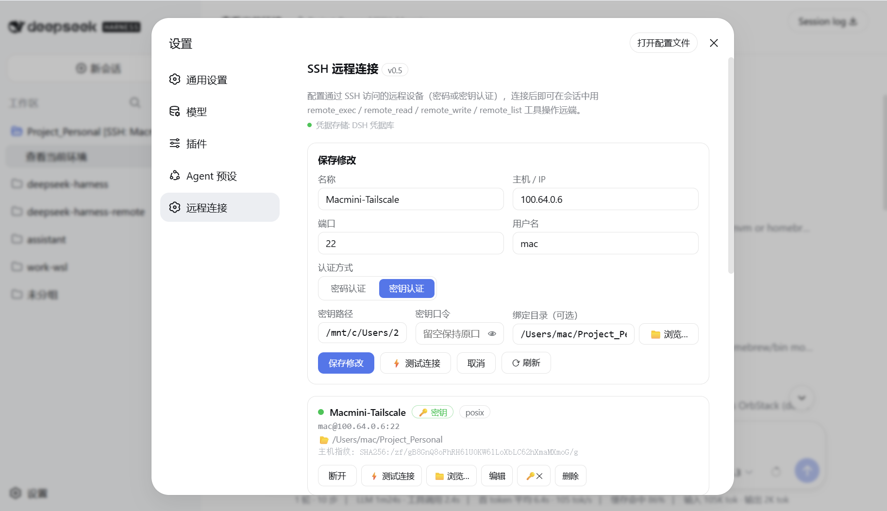
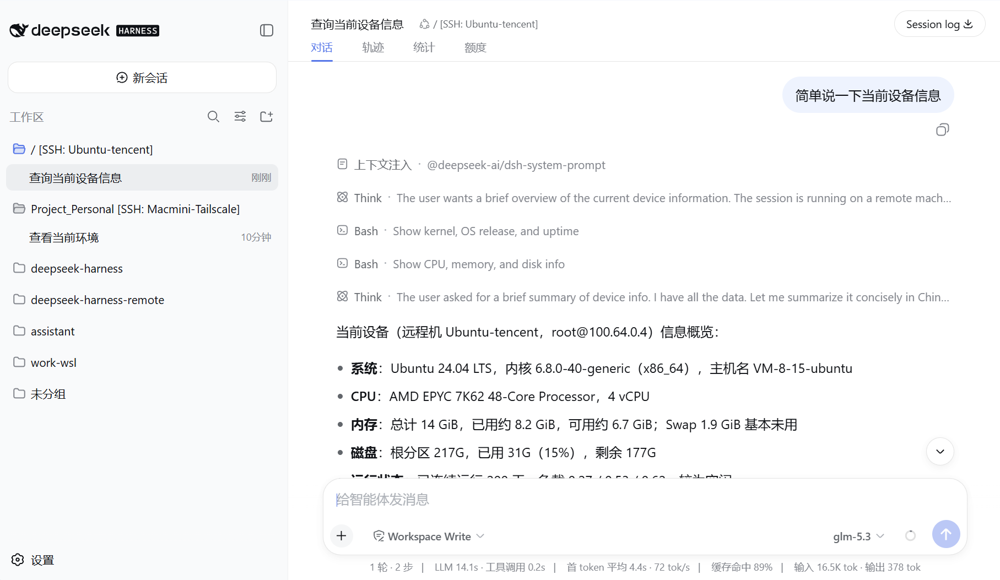

<h1 align="center">DeepSeek Harness Remote Dev</h1>

  <strong>Turn a directory on a remote server into a DeepSeek Harness workspace and develop in it like a local one.</strong> 
  Straight over SSH: browsing, editing, commands and tests all happen remotely — without installing DSH or a remote agent.

  
  
  

  <a href="README.md">简体中文</a> · English ·
  <a href="#install">Install</a> ·
  <a href="#three-steps-to-start">Three steps to start</a> ·
  <a href="#remote-workspaces">Remote workspaces</a> ·
  <a href="#faq">FAQ</a>

  

  

## What is it

An **SSH remote development plugin** for DeepSeek Harness. Connect to any machine you can SSH into and add one of its directories as a workspace — every session you start there runs `read` / `write` / `edit` / `glob` / `grep` / `bash` **inside that directory on that machine**.

The experience matches VS Code Remote Development: the UI and the model run locally, the files and commands run remotely.

The remote machine does not need DSH or an agent. It needs an SSH server and a login account; standard search tools additionally require remote `rg`.

## Compatibility and prerequisites

This branch targets **DeepSeek Harness 0.2.2-rc.3**. Core interfaces are optional peer dependencies supplied by the host, so installing the plugin does not pull old core packages into a profile. `engines.dsh` restricts the verified runtime; do not bypass the check to assume other releases work.

Full remote workspaces currently target POSIX servers (Linux, macOS, WSL). Standard `glob` / `grep` run **ripgrep (`rg`) on the remote PATH** through SSH subprocesses. Missing remote ripgrep fails explicitly; searches never fall back to the host. Windows connections, SFTP and standalone `remote_dev_*` tools remain available; standard workspace process execution, PTYs, separate control channels and raw-output spill are not implemented.

Cancellation and deadlines close only the operation's SSH channel, preserving the shared connection. Channel closure does not prove remote process-tree termination. Guarded SFTP edits still depend on server metadata precision for external equal-size writes within one timestamp interval. Replacement writes no longer unlink a destination to retry rename.

## Install

### Option 1: one command (recommended)

~~~sh
npx dsh-remote-dev@latest setup
~~~

Installs into the `web` profile; add `--profile headless` for another one.

The installer prepares the profile directory, records the pnpm build policy, installs, registers the plugin, and verifies it took effect. It is idempotent — after a failed install, run it again to repair.

### Option 2: install with the dsh command

First add two lines to `~/.dsh/profiles/web/pnpm-workspace.yaml`:

~~~yaml
allowBuilds:
  ssh2: false
  cpu-features: false
~~~

Then install as usual:

~~~sh
pnpm dsh plugin --profile web add dsh-remote-dev
# or, with dsh installed globally:
dsh plugin --profile web add dsh-remote-dev
~~~

**What are those two lines for?** This plugin depends on `ssh2`, which carries two **optional** native build scripts (its own `install`, plus node-gyp for the optional `cpu-features`). pnpm 11 fails the entire install over any build script you have not decided about (`ERR_PNPM_IGNORED_BUILDS`). Neither build is needed — ssh2 is a pure JavaScript client that falls back to Node's own crypto — so denying them is the right answer, and it means no C++ toolchain is required. Option 1 does exactly this.

> Want the native accelerator anyway? `npx dsh-remote-dev@latest setup --allow-native` (needs a C++ toolchain).

## Three steps to start

1. Start DeepSeek Harness (`dsh --profile web`), open **Settings → Remote Connections**, enter host, port, username and authentication, select **Test connection**, and save.
2. In the sidebar choose **Add workspace → Remote machines**, pick the machine, browse to the directory, and confirm.
3. The directory appears as a workspace (`app [SSH: buildbox]`). Start a session under it and begin.

## Remote workspaces

This is the main way to use the plugin. In every session under a remote workspace:

- `read` / `write` / `edit` operate over SFTP; `glob` / `grep` run remote `rg` through SSH;
- `bash` runs commands over SSH inside the remote directory;
- relative paths resolve against the remote directory and `{{cwd}}` shows it, so the local path never leaks into the model's reasoning;
- persona, AGENTS.md, skills, todos, plan mode and subagents **all remain** — the remote preset is derived from your default preset, not reduced to a handful of tools;
- reopening an old session returns to the same remote environment.

Local workspaces are untouched.

## What you get

| Capability | Detail |
| --- | --- |
| Remote workspaces | A remote directory as a workspace; files and commands run there |
| Connection manager | Add, test, edit, connect and browse machines from Settings |
| Authentication | Password, private key, key passphrase; host fingerprint pinned on first connect |
| Directory browser | Built-in SFTP browser with breadcrumbs and keyboard support |
| Platforms | Linux, macOS, WSL and Windows SSH servers |

For one-off remote work without creating a workspace, the model can call these tools directly:

| Tool | Purpose |
| --- | --- |
| `remote_dev_status` | List profiles, states, platforms and recent errors |
| `remote_dev_connect` / `remote_dev_disconnect` | Open or close a connection |
| `remote_dev_exec` | Run a command over SSH |
| `remote_dev_read` / `remote_dev_write` | Read and write UTF-8 text over SFTP |
| `remote_dev_list` | Browse a remote directory over SFTP |

## FAQ

### Install fails with `[ERR_PNPM_IGNORED_BUILDS] Ignored build scripts: cpu-features@0.0.10, ssh2@1.17.0`

pnpm 11 refuses to skip a dependency's build scripts silently and exits with a **failure**, so `dsh` never registers the plugin in `dsh.profile.bundles` — the package is downloaded but never loaded.

Run the installer once to repair it (it turns the pending placeholders pnpm wrote into an explicit `false`, reinstalls, and registers the bundle):

~~~sh
npx dsh-remote-dev@latest setup
~~~

Or set both entries under `allowBuilds` in `~/.dsh/profiles/web/pnpm-workspace.yaml` to `false` by hand and run the install command again.

### After installing this plugin, installing **other** plugins fails the same way

Same cause: pnpm re-evaluates the whole profile's dependency graph on every install, so as long as `ssh2` is in it and undecided, every install fails. Once `allowBuilds` is written, every plugin in that profile installs normally again.

### Installed, but there is no "Remote Connections" in Settings

Check that `dsh.profile.bundles` in `~/.dsh/profiles/<name>/package.json` contains `dsh-remote-dev`. If it does not, the install failed halfway — run the installer again.

### Other checks

~~~sh
npx dsh-remote-dev@latest setup --dry-run   # show the changes without making them
npx dsh-remote-dev@latest setup --help      # all options
~~~

## Security boundary

- The first connection pins and verifies the SSH host fingerprint; a mismatch fails closed.
- Passwords and key passphrases live in the DeepSeek Harness credential store and are never echoed to the browser.
- Remote commands carry the permissions of that SSH account.
- A bound directory is workspace semantics, **not** an OS sandbox.
- For risky work, use a dedicated account, a container, or a VM.

## Local development

~~~sh
npm ci
npm run test:offline     # tests that need no SSH server
npm run check            # syntax check
npm run package:check    # pack and install into a clean consumer
~~~

Install the checkout into a Web profile:

~~~sh
./scripts/install.sh     # same as: setup --package ./packages/remote-ssh
~~~

## More

- [Remote development design](docs/remote-development-design.md)
- [Publishing guide](docs/PUBLISHING.md)
- [Maintainer handover](docs/HANDOVER.md)
- [Changelog](CHANGELOG.md)
- [MIT License](LICENSE)

A community-maintained plugin, not an official DeepSeek AI product.
